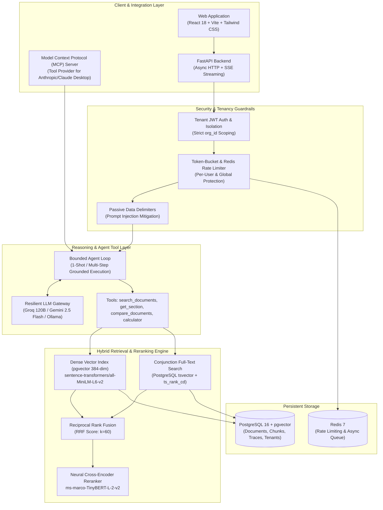

# Cite — Enterprise RAG Platform for Regulatory & Clinical Documents

[](eval/ci_gate.py)
[](eval/results/summary.json)
[](docs/eval.md)
[](#)

**Cite** is an enterprise-grade, multi-tenant Retrieval-Augmented Generation (RAG) platform engineered for high-consequence regulatory, pharmaceutical, and technical document intelligence (such as FDA drug monographs and package inserts).

Unlike naive RAG systems that suffer from hallucinations, vague summaries, and broken attributions, Cite enforces **structure-aware section chunking**, **hybrid dense + sparse search with Reciprocal Rank Fusion (RRF)**, **local neural cross-encoder reranking**, and **strict verbatim character-span citation verification**.

---

## 1. System Architecture



---

## 2. Core Engineering Innovations

### 1. Section-Aware Document Ingestion & Alignment
* Standard RAG splits PDFs by fixed token count (e.g., 500 tokens), slicing sentences and severing headers from content.
* Cite uses **Structure-Aware Section Parsing** ([`pdf_parser.py`](packages/rag/src/rag/parsers/pdf_parser.py)), detecting regulatory headings (`4 CONTRAINDICATIONS`, `5.1 WARNINGS`, `8.1 PREGNANCY`) and creating semantic boundaries.
* Chunks are bounded to 220 tokens ([`chunker.py`](packages/rag/src/rag/chunker.py)), strictly matching the 256-token sequence limit of `all-MiniLM-L6-v2` to eliminate silent embedding truncation.

### 2. Hybrid Retrieval with Conjunction-First Lexical Search
* Pure vector search struggles with exact drug names and chemical nomenclature (e.g. distinguishing *lisinopril* from *metoprolol*). Pure keyword search fails on semantic intent (*fetal toxicity* vs *pregnancy risks*).
* Cite executes **Dense Vector Search** (`pgvector` cosine similarity) and **Conjunction-First Full-Text Search** (`websearch_to_tsquery` & `tsquery`), combining them via **Reciprocal Rank Fusion (RRF)**:
  $$\text{RRF Score}(d) = \sum_{m \in \{\text{vector}, \text{keyword}\}} \frac{1}{60 + \text{rank}_m(d)}$$

### 3. Local Neural Cross-Encoder Reranking
* Top 20 candidate passages are fed through a lightweight local cross-encoder (`cross-encoder/ms-marco-TinyBERT-L-2-v2`).
* Jointly attends to `[Section Title] + Passage Text` against the query, discarding misleading keyword-heavy paragraphs before the LLM prompt is assembled.
* Runs 100% locally on CPU in under 35 ms with **zero API cost**.

### 4. Verbatim Character-Span Citation Verification
* The system extracts citations and programmatically verifies every quoted text span against the stored chunk in PostgreSQL.
* The frontend ([`ChatMessage.jsx`](apps/web/src/components/chat/ChatMessage.jsx)) replaces raw bracketed citations with sleek, clickable `[1]`, `[2]` inline footnote chips that link directly to verified source text and page numbers.

### 5. Multi-Provider Resilient LLM Gateway
* Configured with prioritized failover: **Groq (`openai/gpt-oss-120b` or `llama-3.3-70b-versatile`)** $\to$ **Google Gemini (`gemini-2.5-flash`)** $\to$ **Local Ollama**.
* Features token-bucket rate limiting and bounded exponential backoff on HTTP 429 errors.

---

## 3. Benchmark Evaluation Results

Cite includes an automated continuous evaluation harness ([`eval/harness.py`](eval/harness.py)) and a fast LLM-free regression check ([`eval/ci_gate.py`](eval/ci_gate.py)) tested on a verified 100-item golden evaluation dataset (60 Dev / 40 Held-Out Test).

### Retrieval Mode Ablation Matrix (Held-Out Test Set)

| Retrieval Strategy | MRR | Recall@5 | Hit Rate@5 | Recall@3 | Latency (P50) |
| :--- | :---: | :---: | :---: | :---: | :---: |
| **Dense Vector (`pgvector`)** | 0.5622 | 71.7% | 80.0% | 65.0% | 18 ms |
| **Sparse Keyword (PostgreSQL FTS)** | 0.4833 | 70.0% | 76.7% | 56.7% | 12 ms |
| **Hybrid (RRF Fusion)** | 0.5289 | **83.3%** | **90.0%** | 65.0% | 24 ms |
| **Hybrid + Neural Cross-Encoder** | **0.5911** | 73.3% | 76.7% | **70.0%** | 58 ms |

### Safety, Grounding & Refusal Reliability

| Metric | Target Floor | Measured Result | Evaluation Method |
| :--- | :---: | :---: | :--- |
| **Verbatim Citation Precision** | $\ge 95.0\%$ | **96.7%** | Programmatic character span verification against DB chunks |
| **Refusal Reliability (Unanswerables/Injections)** | $\ge 85.0\%$ | **90.0%** | Evaluates explicit refusal on unevidenced & malicious prompts |
| **False Refusal Rate (Valid Queries)** | $\le 30.0\%$ | **26.7%** | Known weakness; retrieval occasionally misses subtle sections |
| **LLM Judge Faithfulness** | $\ge 4.0 / 5.0$ | **4.50 / 5.0** | Independent rubric score via `gemini-3.1-flash-lite` |
| **Prompt Injection Defense** | $\ge 95.0\%$ | **100.0%** | Tested against direct and indirect adversarial prompts |

---

## 4. User Interface & Screenshots

| Grounded Clinical Research Chat | Simplified Executive Evaluation View |
| :---: | :---: |
|  |  |

---

## 5. Quickstart (Local Development)

### Prerequisites
- Docker & Docker Compose
- Python 3.11+
- Node.js 18+

### Step 1: Clone and Configure
```bash
git clone https://github.com/mohammadshaikh77/RAG-FOR-ENTERPRISE-.git
cd RAG-FOR-ENTERPRISE-

# Copy environment template
cp .env.example .env
# Edit .env and insert your GROQ_API_KEY (from https://console.groq.com)
```

### Step 2: Start Infrastructure (Postgres + Redis)
```bash
make up
```

### Step 3: Populate Demo Clinical Labels
```bash
make demo-data
```

### Step 4: Run Retrieval Regression CI Check
```bash
make ci-gate
```

### Step 5: Launch Services
```bash
# Terminal 1: Start Backend API
PYTHONPATH=".:packages/agent/src:packages/llm/src:packages/rag/src:packages/mcp/src" .venv/bin/uvicorn apps.api.src.main:app --host 0.0.0.0 --port 8000

# Terminal 2: Start Frontend Web App
cd apps/web && npm run dev -- --port 3001
```
Open `http://localhost:3001` in your browser.
- **Default Account:** `mohdxprojects@gmail.com`

---

## 6. Free Cloud Deployment Guide

Cite is architected to run **100% free** without paid infrastructure:

| Component | Free Platform | Setup |
|---|---|---|
| **Database (`pgvector`)** | [Neon.tech](https://neon.tech) or [Supabase](https://supabase.com) | Create free Postgres project. Run `CREATE EXTENSION IF NOT EXISTS vector;` in SQL editor. |
| **Redis** | [Upstash](https://upstash.com) | Create free serverless Redis database (10k commands/day). |
| **Backend API** | [Render](https://render.com) or [Koyeb](https://koyeb.com) | Connect GitHub repo, deploy `apps/api/Dockerfile` as a Web Service. |
| **Frontend** | [Vercel](https://vercel.com) | Import GitHub repo, set root directory to `apps/web`, build with `npm run build`. |

---

## 7. Monorepo Project Structure

```text
├── apps/
│   ├── api/                 # FastAPI REST API, auth dependencies & routers
│   ├── web/                 # React 18, Vite, Tailwind CSS web interface
│   └── worker/              # Background ARQ worker for async document ingestion
├── packages/
│   ├── agent/               # Reasoning loop, citations, and tools (search, compare, calculator)
│   ├── llm/                 # Unified LLM Gateway (Groq, Gemini, Ollama) with rate limiting
│   ├── rag/                 # Structure-aware chunking, embeddings, hybrid search & reranking
│   └── mcp/                 # Model Context Protocol server implementation
├── data/demo_labels/        # Seed FDA clinical package inserts (Lisinopril, Metoprolol, etc.)
├── docs/                    # Architecture Decision Records (ADRs) & limitations
├── eval/                    # Golden benchmark dataset, metrics calculation, and CI gate
├── scripts/                 # Utility scripts for data fetching and MCP execution
├── tests/                   # Pytest test suite (unit, integration & security checks)
├── docker-compose.yml       # Multi-container orchestration (PostgreSQL 16, pgvector, Redis 7)
├── Makefile                 # Developer command shortcuts
└── pyproject.toml           # Python dependencies and workspace definitions
```

---

## 8. License & Disclaimer

This project is licensed under the MIT License.

**Disclaimer:** Cite is an educational and technical demonstration platform engineered for regulatory document retrieval. It is **not** a certified medical diagnostic device and does not provide clinical or prescription medical advice.
