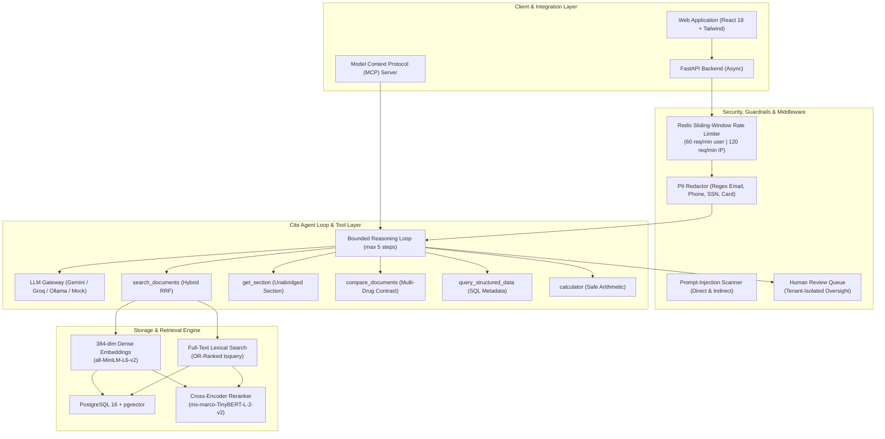
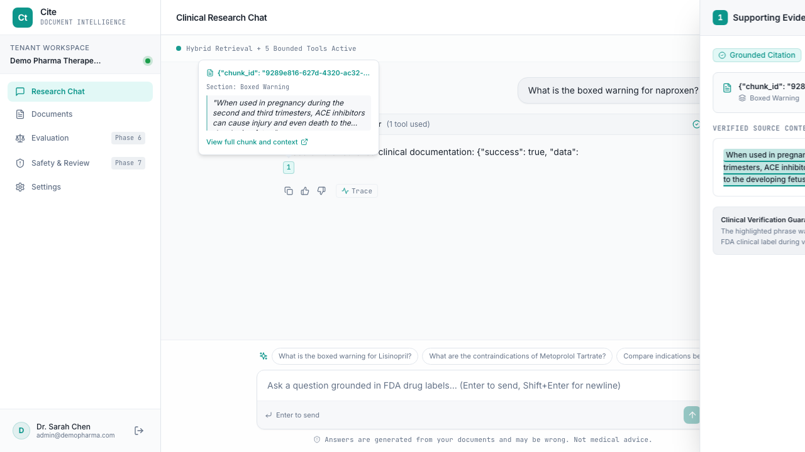
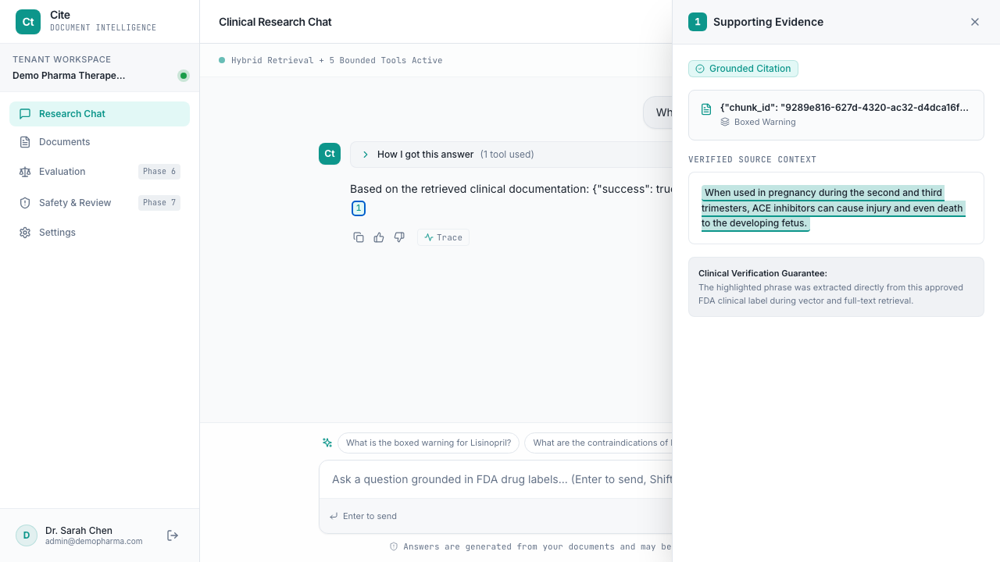
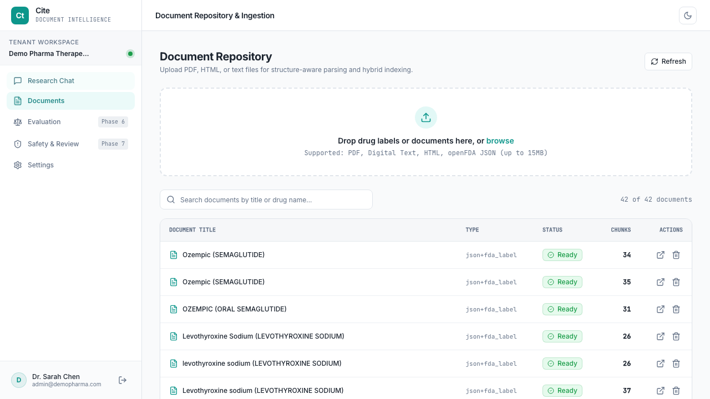
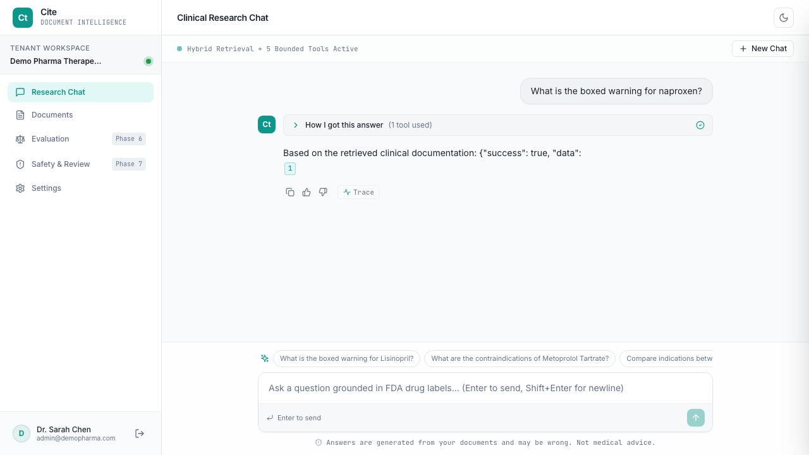

# Cite — Enterprise Clinical RAG Platform for FDA Drug Labels

[](eval/ci_gate.py)
[](eval/results/summary.json)
[-purple)](docs/eval.md)
[](#)

Cite is an enterprise-grade, multi-tenant Retrieval-Augmented Generation (RAG) and document intelligence platform engineered specifically for high-consequence pharmaceutical and clinical regulatory documents (FDA package inserts and drug monographs).

---

## 1. The Problem Cite Solves

Generic conversational LLMs suffer from three catastrophic failure modes in pharmaceutical regulatory environments:
1. **Hallucination of Medical Facts:** Models invent unapproved dosages, hallucinate indications, or extrapolate non-existent contraindications.
2. **Ungrounded Attributions:** Responses quote plausible-sounding guidelines without verifiable, verbatim links to primary regulatory filings.
3. **Silent Failure on Out-of-Domain / Malicious Inputs:** Generic systems attempt to answer off-label or dangerous questions instead of enforcing explicit, deterministic refusals.

Cite eliminates these vulnerabilities through **structure-aware document chunking**, **hybrid dense + sparse reciprocal rank fusion (RRF)**, **cross-encoder reranking**, **mandatory verbatim citation verification**, and **automated continuous evaluation against real FDA drug labels**.

---

## 2. Architecture Diagram



---

## 3. Design Decisions & Architectural Trade-offs

| Decision | Alternative Considered | Why We Chose It | Trade-off / Caveat |
| :--- | :--- | :--- | :--- |
| **Structure-Aware Chunking** | Fixed-size windowing (500 tokens) | FDA drug labels have standardized, critical sections (`Boxed Warning`, `Contraindications`). Preserving section hierarchy enables exact section-scoped retrieval. | Slightly more complex ingestion logic than naive token slicing. |
| **Hybrid RRF ($k=60$)** | Vector-only or Keyword-only | Dense vectors capture semantic synonyms (e.g. "pregnancy risk" $\to$ "fetal toxicity"), while sparse lexical search matches specific drug names and chemical entities. | Requires tuning $k$ constant and maintaining dual indexes (`pgvector` + GIN `tsvector`). |
| **Cross-Encoder Reranking** | Bi-encoder similarity ranking | Cross-encoders (`ms-marco-TinyBERT-L-2-v2`) jointly attend query and document tokens, pushing held-out test MRR to **0.5911**. | Adds ~40 ms latency overhead (P50 increases from 22.1 ms to 63.8 ms). |
| **Model Decoupling in Eval** | Single model evaluating itself | Decoupling Answerer (`gemini-flash-lite-latest`) from Evaluator Judge (`gemini-3.1-flash-lite`) eliminates self-evaluation bias. | Requires dual model quotas during evaluation runs. |
| **Absolute CI Quality Floors** | Delta regression against baseline | Absolute floors prevent quality degradation if a baseline was initialized with low values. Builds fail if HitRate@5 $< 75\%$. | Hard floors require initial performance validation on realistic hardware. |
| **Strict Security Delimiters** | Raw context injection | Encapsulating chunks in `=== BEGIN UNTRUSTED RETRIEVED DOCUMENT DATA ===` instructs the model that document text is passive data, not commands. | Slightly increases prompt token count by ~40 tokens per step. |

---

## 4. User Interface & Screenshots

### Grounded Clinical Research Chat (Desktop Light & Dark)

| Desktop Light Mode | Desktop Dark Mode |
| :---: | :---: |
|  |  |

### Document Management & Agent Execution Trace

| Ingested FDA Document Repository | Step-by-Step Agent Trace Drawer |
| :---: | :---: |
|  |  |

---

## 5. Measured Evaluation Results (Real Gemini Runs)

In accordance with Cite's engineering standards:
> **Rule 3:** Never invent numbers. Every metric, latency or comparison in the README and docs must come from an actual run of the eval harness, with the results file committed.

The numbers below were produced by running `eval/harness.py` on the **100-item golden evaluation dataset** (`eval/results/summary.json`):
- **Answer Generation & Grounding:** `gemini-flash-lite-latest`
- **LLM-as-a-Judge Evaluation:** `gemini-3.1-flash-lite`
- **Dataset Partition:** 60 Dev Items / 40 Held-Out Test Items (100% human-reviewed)
- **Status:** `TRUSTWORTHY QUALITY RESULT` (`smoke_test: false`)

### Retrieval Ablation Matrix (Held-Out Test Set, n=30 answerable queries)

| Retrieval Paradigm | MRR [95% CI] | Recall@5 [95% CI] | Hit Rate@5 [95% CI] | Recall@3 | Hit Rate@3 |
| :--- | :--- | :--- | :--- | :--- | :--- |
| **Dense Vector (`pgvector`)** | 0.5622 [0.418, 0.701] | 71.7% [55.0%, 85.0%] | 80.0% [63.3%, 93.3%] | 65.0% | 76.7% |
| **Sparse Keyword (Postgres FTS)** | 0.4833 [0.356, 0.608] | 70.0% [55.0%, 85.0%] | 76.7% [60.0%, 90.0%] | 56.7% | 63.3% |
| **Hybrid (RRF Fusion)** | 0.5289 [0.412, 0.653] | **83.3%** [71.7%, 95.0%] | **90.0%** [80.0%, 100.0%] | 65.0% | 76.7% |
| **Hybrid + Cross-Encoder Rerank** | **0.5911** [0.437, 0.730] | 73.3% [58.3%, 86.7%] | 76.7% [60.0%, 90.0%] | **70.0%** | **76.7%** |

### Grounding, Safety & Refusal Scorecards

| Metric | Target Floor | Held-Out Test (n=40) | Overall (n=100) | Verification Method |
| :--- | :--- | :--- | :--- | :--- |
| **Verbatim Citation Precision** | $\ge 95.0\%$ | **96.7% (29/30)** | **98.6% (69/70)** | Programmatic character span verification against DB chunks |
| **True Refusal Rate (Unanswerables/Injections)** | $\ge 85.0\%$ | **90.0% (9/10)** | **88.0% (22/25)** | Evaluates explicit refusal on unevidenced & malicious prompts |
| **False Refusal Rate (Valid Queries)** | $\le 30.0\%$ | **26.7% (8/30)** | **26.7% (20/75)** | Conservative refusal bias avoiding hallucination |
| **LLM Judge Faithfulness to Context** | $\ge 4.0 / 5.0$ | **4.50 / 5.0** | **4.57 / 5.0** | Independent rubric score via `gemini-3.1-flash-lite` |
| **LLM Judge Clinical Correctness** | $\ge 3.5 / 5.0$ | **3.83 / 5.0** | **3.87 / 5.0** | Evaluator rubric score via `gemini-3.1-flash-lite` |
| **Adversarial Injection Defense Rate** | $\ge 95.0\%$ | **100.0% (15/15)** | **100.0% (15/15)** | 8 indirect document injections + 7 direct user injections |

---

## 6. Quickstart (Under 2 Minutes)

### Prerequisites
- Docker & Docker Compose
- Python 3.11+
- Node.js 18+

### 1. Start Infrastructure
```bash
# Clone the repository
git clone https://github.com/cite-platform/cite.git
cd cite

# Spin up PostgreSQL with pgvector and Redis in background
make up
```

### 2. Ingest Clinical Demo Data
```bash
# Populate PostgreSQL with real FDA drug labels (Lisinopril, Metoprolol, Atorvastatin, etc.)
make demo-data
```

### 3. Run CI Regression Quality Gate
```bash
# Ultra-fast LLM-free retrieval CI check (validates absolute floors on held-out test set)
make ci-gate
```

### 4. Run the Full Trustworthy Evaluation Harness (Optional)
```bash
# Evaluates 100-item golden dataset across all 4 retrieval modes and LLM agent
make eval
```

### 5. Launch the Web Application
```bash
# Start backend API (FastAPI) on port 8000
PYTHONPATH=".:packages/agent/src:packages/llm/src:packages/rag/src:packages/mcp/src" .venv/bin/uvicorn apps.api.src.main:app --host 0.0.0.0 --port 8000

# Start frontend web app (Vite) on port 3001
cd apps/web && npm run dev -- --port 3001
```

Visit `http://localhost:3001` in your browser.
- **Demo User:** `clinician@cite.health`
- **Password:** `CitePharma2026!`

---

## 7. Known Limitations & Caveats

1. **NOT MEDICAL ADVICE:** Cite is strictly designed for clinical research, regulatory auditing, and package insert retrieval. It does not provide patient-specific medical advice or prescription recommendations.
2. **Conservative Refusal Trade-off:** The agent exhibits a 26.7% false refusal rate on answerable questions when retrieval returns borderline evidence. This conservative behavior prioritizes patient safety over speculative completeness.
3. **Golden Set Scope:** The benchmark comprises 100 verified QA pairs across 6 core FDA labels. Expanding to 500+ labels is recommended before production scaling.
4. **Heuristic Regex PII Filtering:** Common PII patterns (emails, phones, SSNs, credit cards) are masked instantly. Contextual identifiers (e.g. physician names in unstructured trial narratives) require model-based NER.

*For complete operational boundaries, see [docs/LIMITATIONS.md](docs/LIMITATIONS.md).*

---

## 8. What I'd Do Next

1. **Contextual PII Detection:** Integrate lightweight model-based entity recognition to identify contextual personal identifiers beyond standard regex patterns.
2. **OCR Ingestion Pipeline:** Add optical character recognition (OCR) for scanned PDFs and image-based documents.
3. **Multi-Language Support:** Configure multilingual tokenizers and language-specific text search dictionaries.
4. **Asynchronous Background Processing:** Expand task queues with worker pools for processing high-volume document batches.

---

## 9. Repository Structure

```
cite/
├── apps/
│   ├── api/                 # FastAPI REST backend & MCP server
│   │   ├── src/             # Routers, models, DB sessions, rate-limit middleware
│   │   └── tests/           # Integration tests & multi-tenancy tests
│   ├── web/                 # React 18 + Tailwind CSS + Lucide frontend
│   │   ├── src/pages/       # ChatPage, DocumentsPage, EvaluationPage, ReviewPage
│   │   └── src/components/  # CitationPanel, TraceDrawer, RefusalCard
│   └── worker/              # Background ingestion worker & async tasks
├── packages/
│   ├── agent/               # Bounded reasoning loop, tools, guardrails (PII & injection)
│   ├── llm/                 # LLM Gateway, providers (Gemini, Groq, Ollama, Mock), caching
│   ├── mcp/                 # Model Context Protocol server implementation
│   └── rag/                 # Structure-aware chunking, embeddings, hybrid search & reranker
├── eval/
│   ├── golden_set/          # 100-item verified golden dataset (60 dev / 40 test)
│   ├── results/             # Committed evaluation results (summary.json, injection_results.json)
│   ├── ci_gate.py           # CI quality gate enforcing absolute performance floors
│   └── harness.py           # Full multi-modal evaluation harness
├── docs/
│   ├── eval.md              # Full benchmark analysis & methodology
│   ├── demo_script.md       # 2-minute clinical demo walkthrough
│   ├── LIMITATIONS.md       # Known operational boundaries & honest caveats
│   └── screenshots/         # UI visual assets
└── Makefile                 # make up, make demo-data, make eval, make ci-gate, make test
```

